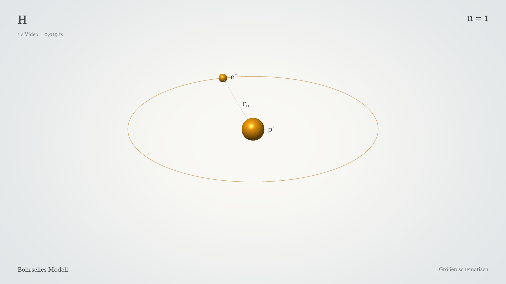

# Bohrs Atommodell

Sieben ruhige 3D-Szenen und eigenständige Diagramme für die Erklärung des Bohrschen
Wasserstoffmodells. Goldene Kugeln auf hellem Hintergrund, wenige Formeln und eine
feste, reproduzierbare Kamera führen von der Kreisbewegung bis zu Spektrallinien
und zum Unterschied zwischen einer Bohrbahn und einer quantenmechanischen Dichte.



Die Rechnungen stehen ausdrücklich in Python. Der Physikkern benötigt nur die
Standardbibliothek; NumPy, ModernGL und Pillow dienen der Grafik. Es gibt keine
SciPy- oder Manim-Abhängigkeit und keine verschachtelten Produktionsschleifen.

## Start unter Windows

Voraussetzungen: Python 3.11 oder neuer und ein Grafiktreiber mit OpenGL 3.3.
Im Projektordner einmalig ausführen:

```powershell
python -m venv .venv
.\.venv\Scripts\python.exe -m pip install -e ".[all]"
.\.venv\Scripts\python.exe -m bohr_atom view
```

Anschließend öffnet ein Doppelklick auf **Start.cmd** die Vorschau. Alternativ:

```powershell
.\Start.ps1
.\Start.ps1 -Mode view --scene vectors --n 2
```

Die Startdateien benutzen ausschließlich die lokale `.venv`. Sie verändern keine
globale Python-Installation. Unter Linux/macOS entsprechen die Befehle
`.venv/bin/python`; das interaktive Fenster benötigt eine grafische Sitzung.

## Bedienung

| Eingabe | Wirkung |
| --- | --- |
| Linke Maustaste ziehen | Kamera drehen |
| Leertaste | Szenenzeit anhalten/fortsetzen |
| Tab / Umschalt+Tab | Nächste/vorherige Szene |
| 1 bis 6 | Hauptquantenzahl auswählen |
| R | Zeit und manuelle Kamera zurücksetzen |
| Esc | Fenster schließen |

Im Spektrum sind nur Anfangsniveaus ab `n=3` sinnvoll; die Tasten 1 und 2 ändern
dort nichts. Beim Wechsel zum Spektrum wird gegebenenfalls `n=3` gewählt. Die
Szenen wiederholen sich in der interaktiven Vorschau nach ihrer Laufzeit.

## Szenen und Produktion

| Datei | Inhalt | Standardzustand |
| --- | --- | --- |
| `01_orbit.mp4` | Kreisbewegung im Bohrmodell | n=1 |
| `02_vectors.mp4` | Orts-, Geschwindigkeits- und Kraftvektoren | n=1 |
| `03_quantization.mp4` | Quantisierungsbedingung und erlaubte Radien | n=3 |
| `04_comparison.mp4` | Gemeinsamer Größen- und Zeitvergleich | n=1, 2, 3 |
| `05_energy.mp4` | Kinetische, potentielle und Gesamtenergie | n=1 |
| `06_spectrum.mp4` | Ein Übergang zum Niveau n=2 | n=3 → 2 |
| `07_orbital.mp4` | Bohrbahn und quantenmechanische 1s-Dichte | n=1 |

Jeder Clip dauert standardmäßig **36 Sekunden** bei **1920 × 1080 und 30 fps**.
Der Gesamtfilm `Bohrs_Atommodell_Alle_Szenen.mp4` dauert **252 Sekunden (4:12)**.
Die Dateien sind stumm, in H.264/yuv420p mit CRF 18 gespeichert und für einen
eigenen gesprochenen Kommentar gedacht. Intern wird standardmäßig mit doppelter
Breite und Höhe gerendert. Beim ganzzahligen Zwei- oder Dreifach-Supersampling
bildet ein Flächenfilter den gleich gewichteten Mittelwert jedes Pixelblocks;
für andere Größenverhältnisse wird Lanczos verwendet.
Im Gesamtfilm blenden die Clipränder jeweils 0,4 Sekunden weich zum hellen
Hintergrund. Die Laufzeit und sämtliche Bildzeitpunkte bleiben erhalten;
die Einzelclips enthalten diese Blenden nicht.

```powershell
# Sieben Einzelclips und ein Gesamtfilm
.\.venv\Scripts\python.exe -m bohr_atom clips

# Ein einzelner Clip
.\.venv\Scripts\python.exe -m bohr_atom render --scene vectors --n 2 --output outputs/vektoren.mp4

# Spektrum: genau ein Übergang n=4 -> 2 im gesamten Clip
.\.venv\Scripts\python.exe -m bohr_atom render --scene spectrum --n 4 --output outputs/spektrum.mp4

# Standbild einer bestimmten Szenenzeit
.\.venv\Scripts\python.exe -m bohr_atom image --scene quantization --seconds 18 --output outputs/quantisierung.png

# Eigenständige 4K-Diagramme
.\.venv\Scripts\python.exe -m bohr_atom plots

# 31 ausgewählte 4K-Standbilder, drei Blickwinkel und weitere Zustände
.\.venv\Scripts\python.exe tools/export_gallery.py
```

Die Standbilder liegen in `outputs/Standbilder`, die sechs Diagramme jeweils als
PNG und SVG in `outputs/plots`. Videos liegen in `outputs/clips`. Die lokal
gerenderten Medien und die Python-Umgebung werden nicht in Git gespeichert;
die Vorschau oben und der gesamte reproduzierbare Quellcode gehören zum Repository.

Ohne `--n` gelten die Szenenwerte aus der Tabelle. Ein explizites `--n` kann von
1 bis 12 reichen; beim Spektrum muss es mindestens 3 sein. Der Vergleich zeigt
immer n=1, 2 und 3, und die Orbitalgegenüberstellung bleibt beim 1s-Zustand.
Der Spektrum-Clip zeigt genau einen Niveauwechsel. Er stellt den Übergang
schematisch dar, nicht eine klassisch berechnete
Elektronenbahn zwischen den erlaubten Niveaus.

`--width`, `--height`, `--duration`, `--fps` und `--supersample` steuern den Export.
`--no-labels` entfernt Beschriftungen. `--fixed-nucleus` verwendet die Näherung
eines unbeweglichen Protons. Die grundlegenden Produktionswerte stehen in
[config.py](src/bohr_atom/config.py). Jeder PNG- oder MP4-Export erhält eine
JSON-Datei mit Szene, Zustand, Auflösung, Zeitdaten und Rendererdiagnostik.
Die Rendererdiagnostik beschreibt das zuletzt gerenderte Bild; `requested_n`
bewahrt bei abweichendem tatsächlichen Zustand die Eingabe.
Beim Gesamtfilm dokumentieren Kapitelmarken die Übergänge zwischen den Clips.

## Physikalische Bedeutung

Das Bohrmodell setzt quantisierte Drehimpulse und strahlungsfreie erlaubte Bahnen
voraus. Diese Postulate werden durch die Animation nicht bewiesen. Das Modell
beschreibt hier ein nichtrelativistisches Wasserstoffatom ohne Spin, Feinstruktur
oder äußere Felder.

Standardmäßig wird die endliche Protonenmasse berücksichtigt. Dabei bezeichnet
`r` den Abstand zwischen Elektron und Proton; `v` ist ihre Relativgeschwindigkeit.
Die reduzierte Masse lautet `μ = mₑmₚ/(mₑ+mₚ)`. Mit
`κ = e²/(4πε₀)` folgen aus Coulombkraft und `L = nℏ`:

```text
rₙ = ℏ² n² / (μ κ)
vₙ = κ / (ℏ n)
Eₙ = −μ κ² / (2ℏ² n²)
Tₙ ∝ n³
```

Bei festem Kern wird `μ` durch `mₑ` ersetzt. Bei endlicher Kernmasse bewegen sich
beide Teilchen um den gemeinsamen Schwerpunkt. Kugelgrößen sind zur Erkennbarkeit
vergrößert und keine physikalischen Teilchenradien. Einzelansichten können eigene
Darstellungsmaßstäbe benutzen; die Vergleichsszene verwendet ausdrücklich einen
gemeinsamen Maßstab und eine gemeinsame physikalische Zeit.

Die Spektralfarbe folgt der Energiedifferenz `hν = Eᵢ − E𝒻` und `λ = c/ν`.
Farben kennzeichnen die Spektrallinien; der Clip enthält keine räumliche Photon-
oder Wellenanimation. Die 1s-Punktwolke repräsentiert
eine Wahrscheinlichkeitsdichte eines Elektrons; ihre Punkte sind keine vielen
Elektronen und keine Bohrbahnen. Die physikalischen Konstanten verwenden
[CODATA-2022-Werte](https://physics.nist.gov/cuu/Constants/Table/allascii.txt).

In der Gegenüberstellung benutzen Bohrbahn und 1s-Wolke dieselbe Skala für die
Elektronenposition relativ zum Schwerpunkt. Die Wolke wird bei einem relativen
Abstand von `6a_μ` abgeschnitten; darin liegen etwa **99,9478 %** der
1s-Wahrscheinlichkeit. Die verbleibenden Punkte werden nicht neu skaliert.

## Aufbau und optionale Komponenten

| Datei | Verantwortung |
| --- | --- |
| `physics.py` | SI-Konstanten und sämtliche Modellrechnungen, nur Standardbibliothek |
| `config.py` | Explizite Produktionswerte |
| `renderer.py`, `shaders.py`, `camera.py` | 3D-Darstellung und Kameraführung |
| `presentation.py` | Formeln, Beschriftungen und eigenständige Diagramme |
| `viewer.py` | Fenster, Maus und Tastatur |
| `export.py` | PNG, MP4, Metadaten und Gesamtfilm |
| `cli.py` | Parameter und Startbefehle |

Die Grundinstallation `pip install -e .` genügt für Bilder. Das Extra `[viewer]`
ergänzt GLFW, `[video]` ergänzt PyAV, `[all]` enthält beide. `[dev]` enthält
zusätzlich die Werkzeuge für Tests und Stilprüfung. Die Bilderzeugung lädt keinen
Videoencoder zwingend; alle Szenen verwenden dieselbe Rendererschnittstelle.

## Prüfung

```powershell
.\.venv\Scripts\python.exe -m pip install -e ".[dev]"
.\.venv\Scripts\python.exe -m unittest discover -s tests -v
.\.venv\Scripts\python.exe -m ruff check .
.\.venv\Scripts\python.exe tools/verify_media.py --plots outputs/plots
```

Die Anwendungstests prüfen insbesondere frühe Eingabevalidierung, Ressourcenfreigabe,
Erhalt vorhandener Dateien bei Exportfehlern und die Zeitstempel an Clipgrenzen.
GitHub Actions führt die CPU-Tests unter Windows und Linux aus; ein GPU-Render wird
dort nicht vorausgesetzt. Die Medienprüfung dekodiert jedes ausgelieferte Videobild
und kontrolliert Bildzahl, Auflösung, FPS, Zeitstempel, Stummheit und Metadaten. Sie
schreibt einen kompakten JSON-Bericht sowie ausgewählte Standbilder und einen Kontaktbogen.
